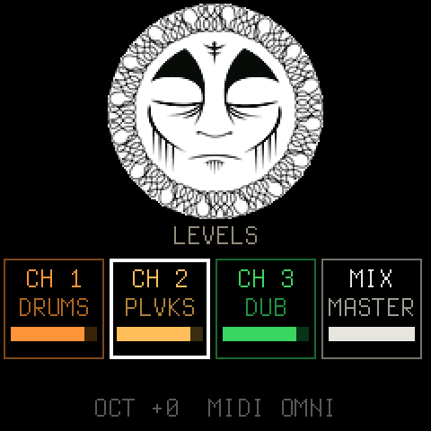
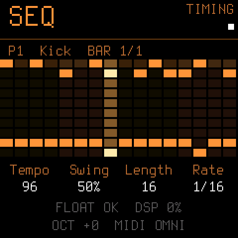
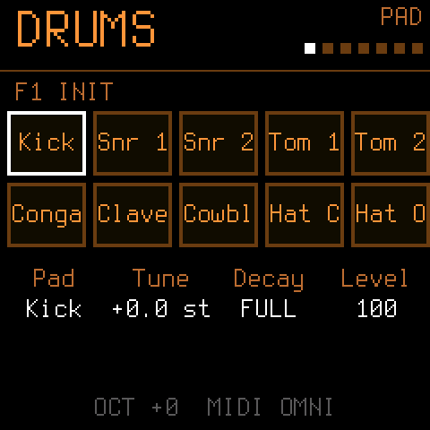
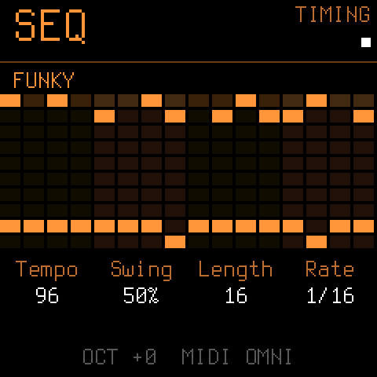

# CULTBOX

**A three-channel groovebox for the M-VAVE FM-1.** Drums, a Polivoks-style synth and a dub siren, each with its own
sequencer, effects and place in the mix. It runs on the FM-1 by itself: no computer needed once it is installed.

<p align="center">




</p>

| Channel | What it is |
| --- | --- |
| **CH 1 DRUMS** | Ten Elka Drummer One sample pads (tune, decay, level, crush, tone, choke), a sine sub under the kick, a 16 to 64 step sequencer with swing, chance, slide and per-step edits, and seven factory patterns (Funky, Impeach, Levee, Walk, Steppers, One-Drop, Rockers). |
| **CH 2 PLVKS** | A duophonic voice after the Formanta Polivoks: two oscillators, the filter, looping envelopes and the LFO, with an arpeggiator, scales and a note sequencer you can record into. Presets included. |
| **CH 3 DUB** | A dub siren after [dubmarine](https://github.com/beatcult/dubmarine): a pitch-swept oscillator, filter, glide on the keys. |
| **Mix and effects** | Levels, echo sends and **pan** per channel (hard-pan two voices into separate mixer channels with a stereo-to-2-mono Y cable); two BBD-style echoes that can follow the tempo; per channel a vintage low-pass, five saturation models and a tape stage. |

The manual is the [CULTBOX dossier](https://cult-box.netlify.app/).

## Install

1. Download **`cultbox.fwsc`** from the [latest release](https://github.com/beatcult/cultbox/releases/latest).
2. Install it with the [FM-1 Firmware Hub](https://thefirmwarehub.com), another M-UPGRADE web installer, or
   `python3 tools/fm1_install.py cultbox.fwsc` (`--info` shows what is on your FM-1 now).
3. To leave CULTBOX, install any other firmware the same way (the update loader is part of the package). If CULTBOX
   ever crashes at boot, hold **OCT-** while switching on: USB rescue, no sound, only the updater.

CULTBOX's package identity is **FM-1_666666**. It accepts both flash chips found in FM-1 units (Puya P25Q80 and the
UC25HQ80 fitted to newer ones), so settings and patterns are saved to flash on either.

## Build it yourself

You need Linux on x86-64 (or Docker), Python 3 with Pillow, the JieLi toolchain (`tools/get_toolchain.sh`) and the
JieLi AC79 SDK (three of its files go in the package). Then:

```
./build.sh                  # -> build/cultbox.fwsc
./build.sh --release 1.0    # the version shown on the screen
sh tests/run_host.sh        # the firmware on your computer: screens as PNG, sound as WAV (tests/host.c explains the scripts)
```

The CI workflows (`.github/workflows/`) build and test every push, and a tag `vX.Y` builds, attests and publishes the
release. The Firmware Hub's card text lives in `fmhub.json`.

## Where it comes from

CULTBOX is a fork of **[Dinghy](https://github.com/zvenson/dinghy)** by zvenson, "the smallest firmware for the FM-1 to
build your own on", and everything underneath the instruments is Dinghy's: the update path, USB rescue, MIDI over USB
and the TRS jack, USB audio, the panel, the screen and the flash storage. Dinghy in turn carries the platform of
**[Felucca](https://github.com/hugelton/Felucca)** (Leo Kuroshita, Hügelton Instruments) as
**[SLOOP](https://github.com/isod89/sloop-fm1)** (isod89), sloopDX and OberVave carry it, with the SMK-37 layer from
genkigenki/sloop-fm1. Its docs are kept in [docs/platform/](docs/platform/). The synth, drums, siren, sequencers, effects
and mixer are CULTBOX's own. [LICENSING.md](LICENSING.md) names who wrote what, and the third-party material.

CULTBOX is free software under the **GNU General Public License, version 3 only**; the complete source is in this
repository at every release tag. "M-VAVE", "FM-1" and the other product names belong to their owners; CULTBOX is not
made or endorsed by them.
